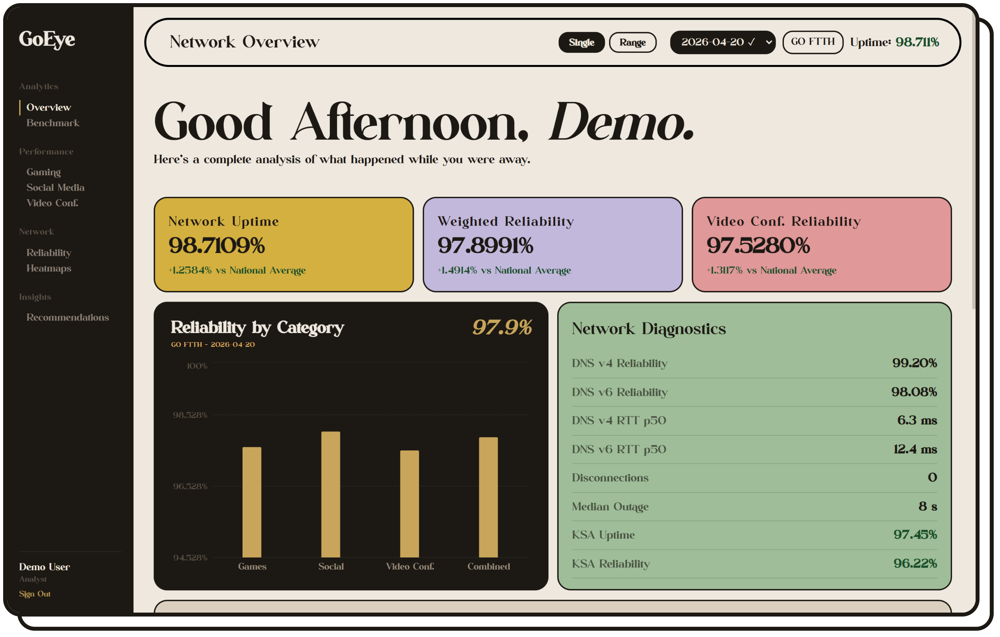
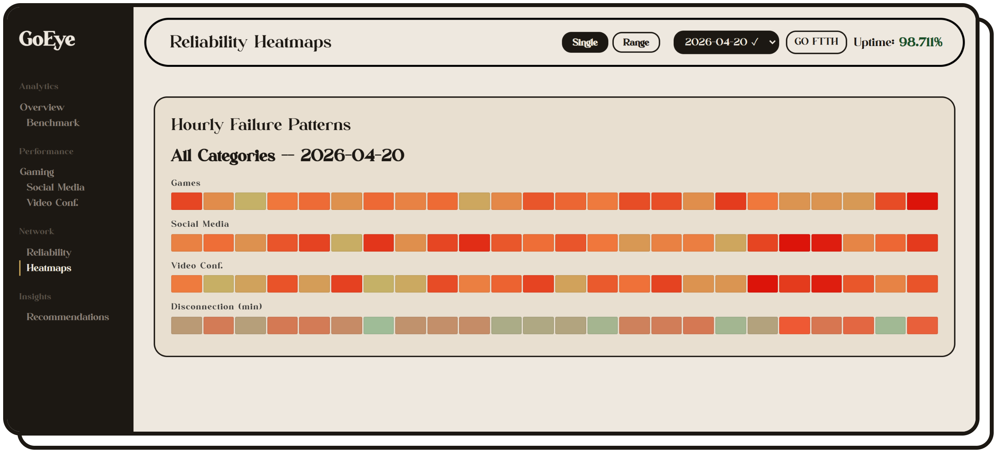
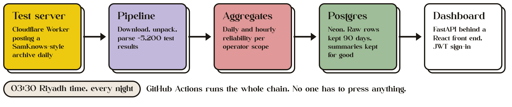

<p align="center">
  
</p>

GoEye is the dashboard I built for Go Telecom to watch home internet quality across
Saudi Arabia. Small test units in subscribers' homes check the connection all day:
game servers, Instagram and TikTok, Zoom and Teams calls, DNS lookups, dropouts.
GoEye collects those results overnight and turns them into one page that tells you
how the night went, and how GO's fibre compares with the KSA average.

This public copy runs on made-up data. The original read SamKnows measurement
exports; this one reads from a stand-in server I built that publishes a fresh,
realistic archive every night. No real subscriber data is in this repo.

<p>
  <a href="https://goeye-dashboard.vercel.app"><picture><source media="(prefers-color-scheme: dark)" srcset="docs/readme/live-demo-dark.png"></picture></a>
</p>

Sign in with `demo` and password `demo1234`. The backend runs on a free tier and is
kept awake, so it normally answers straight away; if it has been asleep, the first
sign-in can take up to a minute.

## What's on the dashboard



- **Overview**: uptime, reliability and video call reliability for the day, each
  compared with the national average, plus DNS health and disconnections.
- **Benchmark**: GO fibre side by side with the STC and Mobily KSA average.
- **Gaming**: latency to 29 game services, from Valorant to Honor of Kings.
- **Social media**: response times per app, split into CDN and origin servers.
- **Video calls**: Zoom, Teams, Google Meet and Webex.
- **Reliability and heatmaps**: failure rate for every hour of the day, so evening
  slowdowns are easy to spot.
- **Recommendations**: plain-language notes on what's weakest and what to look at.

Pick a single day or a date range in the top bar. Dates that are on the test server
but not loaded yet can be pulled in from there too.



## How the data gets here

<picture>
  <source media="(prefers-color-scheme: dark)" srcset="docs/readme/data-flow-dark.png">
  
</picture>

The pipeline is the same one that ran against SamKnows: it lists the archives on the
server, downloads the new one, unpacks the CSVs, loads around 5,200 test results and
rolls them up into daily and hourly numbers per operator. How the stand-in server
and its fake data work is written up in [samknows_sim/README.md](samknows_sim/README.md).
The job is scheduled for 03:30, but GitHub sometimes starts scheduled jobs a few hours
late, so the new day can land later in the morning.

## Run it yourself

You'll need Python 3.11+, Node 20.19+ (or 22.12+) and a PostgreSQL database (a free
[Neon](https://neon.tech) project works).

1. Clone the repo and create your `.env`:

   ```bash
   git clone https://github.com/ahmedhassnain/goeye-dashboard.git
   cd goeye-dashboard
   cp .env.example .env
   ```

   Fill in the database details, and set `JWT_SECRET` to the output of:

   ```bash
   python -c "import secrets; print(secrets.token_hex(32))"
   ```

2. Set up the backend and load the demo data:

   ```bash
   python -m venv venv
   source venv/bin/activate          # Windows: .\venv\Scripts\Activate.ps1
   pip install -r requirements.txt
   python create_tables.py
   python seed_demo_data.py          # 14 days of data and the demo / demo1234 account
   uvicorn api.main:app --reload --port 8001
   ```

   The API docs are at http://localhost:8001/docs.

3. Start the front end. Create `frontend/.env.local` containing
   `VITE_API_URL=http://localhost:8001`, then:

   ```bash
   cd frontend
   npm install
   npm run dev
   ```

   Open http://localhost:5173 and sign in.

4. Optional: run the nightly pipeline locally against a fake test server.

   ```bash
   python samknows_sim/generate_archive.py --days 14
   python samknows_sim/serve_local.py --user demo --password demo
   ```

   The second command keeps running, so use another terminal for the rest. Add
   `SAMKNOWS_URL=http://127.0.0.1:8765/`, `SAMKNOWS_USER=demo` and
   `SAMKNOWS_PASS=demo` to `.env`, then run `python pipeline/run_pipeline.py --days 14`.

## Built with

| Part | Tools |
|---|---|
| Front end | React 19, Vite, Recharts, Axios |
| Back end | FastAPI, SQLAlchemy 2, JWT sign-in with bcrypt passwords |
| Data | PostgreSQL on Neon, pandas and NumPy for the pipeline |
| Hosting | Vercel, Render, cron-job.org, Cloudflare Workers, GitHub Actions |

## Where things live

```
api/main.py                 every API endpoint
pipeline/                   download, run and prune the nightly data
parsers/                    one parser per test type, CSV into raw tables
aggregations/               raw tables into daily and hourly numbers
models/                     database tables
samknows_sim/               the stand-in SamKnows server and data generator
.github/workflows/          the nightly publish-and-load job and the keep-alive ping
frontend/src/pages/         Login and Dashboard
frontend/src/components/    charts, tiles, heatmaps, insights
seed_demo_data.py           demo units, scopes, account and 14 days of data
```

## Deploying

Everything runs on free tiers. Each service needs these settings:

| Service | Settings |
|---|---|
| Neon (database) | Nothing beyond creating the project; copy its connection string |
| Render (API) | Free web service started from the [Procfile](Procfile). Variables: `DATABASE_URL`, `JWT_SECRET`, `RAW_RETENTION_DAYS`, and `SAMKNOWS_URL`, `SAMKNOWS_USER`, `SAMKNOWS_PASS` to load server dates from the dashboard. Steps in [docs/deploy-render.md](docs/deploy-render.md) |
| Vercel (front end) | `VITE_API_URL`, pointing at the API's Render URL; redeploy after changing it |
| cron-job.org (keep-alive) | A job that requests the API's `/docs` every 10 minutes so Render's free tier never reaches its 15-minute sleep. [keep-alive.yml](.github/workflows/keep-alive.yml) does the same from GitHub Actions as a backup once the `BACKEND_URL` repository variable is set |
| GitHub Actions (nightly data) | See [samknows_sim/README.md](samknows_sim/README.md#one-time-cloud-setup-free-tier-no-card-needed) |

[`.env.example`](.env.example) lists every variable with a short note.

The repo also has a [Dockerfile](Dockerfile) for moving the API to a Docker host later; see [docs/deploy-render.md](docs/deploy-render.md#moving-to-a-docker-host-later).

## License

[MIT](LICENSE). Built by Ahmed Hassnain, 2026.
